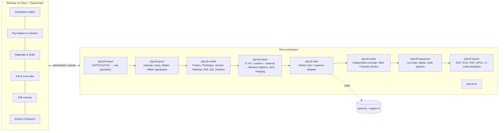

# PlyRoll — plan for a free, local 2D nesting tool for prepreg plies

Status: revised 2026-11-21. **Phase 1 (CLI) is built. Phase 2 has the orientation editor, material library, job settings, live nesting, saved results, cut-file export, reports and import settings. Phase 3 has kit-by-kit nesting.** See the README for usage.

**Phase 3, kit-by-kit nesting (§5.4 kit-aware modes):**
- **Setting:** `JobSettings.grouping` (`global` / `by-kit`), saved with the project (old files load as global), in the app's Nest view and as `plyroll nest --grouping`.
- **How:** `plyroll-core::kits` splits the job at variant level (a kit belongs to an angle variant), in the order kits first appear (shape, then variant; the checklist's order), with "no kit" last and all sets of a kit together. `plyroll-nest::nest_job` nests the sections one after another, each with the lead trim moved to where it starts (previous end + spacing), so the solver output is already in roll coordinates; `kits::merge` maps placements back to the full ply list. Time is shared by ply area, at least 1 s per kit.
- **Stop:** the current kit keeps its best layout and the remaining kits get the solver's first layout, so the result is always complete and verified.
- **Output:** `Layout.sections` (start/end per kit) is saved with the result and in `report.json`; the PDF layout shows a divider and kit names, the checklist gives each kit's stretch, and the app's roll view shows the dividers live. The cut order needs no change: sections do not overlap along the roll, so each kit's cut numbers are one unbroken run.
- **Freshness:** the fingerprint includes the grouping only when it is by-kit, so global results saved earlier stay current.
- **Not done:** groups of N kits per section, and a cross-cut between kits on the cut file.
- **Checked:** core tests (every variant in exactly one section, merge mapping and refusal, stale on change), solver tests (sections in order and end to end, each kit's cut numbers contiguous, live layouts valid, stop after 150 ms still gives every kit, a job without kits is one section), and CLI runs on the demo (kit A 0.02–1.37 m, B 1.37–2.33 m, about 1–4% longer than mixed). The Nest view toggle was checked in the browser preview; the real app was not driven this time (screen control was not approved).

**Phase 2, import settings (so a real job never needs the CLI):**
- **In the app:** units (from each file's `$INSUNITS`, or forced for every file) and join / gap tolerances, stored in the project as before. The dialog lists each DXF with the units it declares. The inspector shows each ply's size in mm.
- **Applying** re-reads every DXF in place (`Project::set_import`): no parts are added, it is one undo step, and every source file must be found and import, or nothing changes. A ply whose outline matches its old outline scaled by the exact unit ratio keeps its confirmed 0°; any other change is flagged. Tolerances are in mm after scaling.
- **Not done:** per-file units (the override applies to every file; `auto` already handles files with `$INSUNITS`) and the layer-mapping profile of §5.2 (the built-in layer names still apply).
- **Checked:** a core test (inch on the demo: refused at the default gap tolerance, then 7 plies rescaled with 0° kept, a mirrored one included, the gusset flagged because its gap is now bridged, result stale, back to auto restores it, removed plies stay removed, missing files refused) and one for a DXF without units switched to inch. In the desktop app: the dialog, a refused change, a rescale and undo; and the Export button from the reports work (all six files, job name from the project file).

**Phase 2, reports:**
- **report.pdf** (A4 landscape, written with `pdf-writer`, base fonts only, nothing embedded): material, used length, both utilisations, scrap, cost, verification, solve time; the layout coloured by angle with cut numbers and a position scale, split into stacked strips for long jobs; then a kit checklist with one tick box per ply, its cut number and position on the roll.
- **labels.csv:** one row per cut ply for label printers (ZPL stays P2).
- **One cut number everywhere:** `plies.csv` order, `labels.csv`, and the report all use `export::cut_order`.
- **Differences from §5.7:** no roll or batch on the report (roll inventory is Phase 3); the checklist is in project order (kit, shape, angle) because the model has no layup sequence yet. Like the cut files, the report and labels are only written when verification passes. The date is UTC.
- **Checked:** unit tests for the checklist (every ply once, kits in order, no-kit last), labels.csv against plies.csv, and no report on a failed layout. Reports for the demo (2 pages) and a 5-set job (11.5 m, 220 plies, 4 pages) were read page by page; Ghostscript parses them without errors.

**Phase 2, second part (material library, nesting, results):**
- **Material library:** one TOML file in the app's config folder (macOS: `~/Library/Application Support/org.plyroll.desktop/materials.toml`), the same format the CLI reads with `--materials`, so it can be shared and edited by hand. TOML instead of the JSON planned in §5.3, so there is one format. The project keeps its own copy of the chosen material; editing the library never changes a project until the material is picked again. A library file that fails to load is never overwritten.
- **Job settings in the project:** material, time budget (30 s / 2 min / 10 min presets or custom) and set multiplier. The multiplier is applied in `plyroll-core` (`Project::nest_input`), so the CLI and the app build the same job.
- **Live nesting:** the adapter maps intermediate solutions to full layouts every ~400 ms. Stop keeps the best layout found, which is complete and verified like a finished one.
- **Saved results:** a project stores the last result with the exact solver input it was made from and a fingerprint of plies, quantities, sets and material. Any edit marks it *out of date* (shown, export disabled); undo makes it current again. Results are outside undo, so undo never deletes a nest. Geometry round-trips bit-exactly (`serde_json` `float_roundtrip`), so a saved result is still current after reopening.
- **Export:** the app writes the same files as the CLI (`report.json`, `layout.svg`, and only when verification passes `layout.dxf`, `plies.csv`, `report.pdf` and `labels.csv`), through one shared `plyroll-core::report` function.
- **CLI:** `-m` is optional for a project that has a material; `--time` defaults to the project's.
- **Checked:** core, nest and round-trip tests (34) pass. In the desktop app: add a material, nest the demo (30 s, stopped at 17 s: 2298 mm, 80.0% of usable area, verified), stale/undo, save, reopen, export. The app's DXF has the same layers and entity counts as a CLI run on the same project (50 cut contours = 44 plies + 6 holes).

**Phase 2, first part (orientation editor):**
- **Project file:** `plyroll-core::project` holds a `.plyroll` JSON project. It caches the geometry, so the project opens without the DXFs. Source paths are stored relative to the project.
- **Re-import:** a part is matched by file and part name and keeps its 0° reference. If its outline signature changed, it is flagged for a check. The signature is translation-invariant but deliberately not rotation-invariant: a part rotated in CAD must be re-checked.
- **References:** 0° is kept in (−90°, 90°]. Edge clicks, two-point picks, rules (X / Y / longest edge / bounding box / fibre layer), typed angles and ±1° / ±15° turns all go through one core function, shared with the CSV path. Mirroring flips the reference and asks for a re-check.
- **Nesting:** blocked while any ply with quantities has no confirmed 0°. Plies without quantities are left out with a warning.
- **App:** a Tauri 2 shell (`app/src-tauri`, Rust commands, undo / redo) with a Svelte 5 UI (`app/src`). The UI has a browser mock fed with real view data, for UI work.
- **CLI:** `nest` and `check` accept `.plyroll`; `convert` turns a job CSV into a project.
- **Checked:** the project path produces the same solver instance as the CSV path. Seeded runs still differ, because the multi-threaded search is time-limited.


**Phase 1 as built (differences from the plan below):**
- **Crates:** three instead of nine. `plyroll-core` holds geometry, import, model, orient, job, verify and export as modules. `plyroll-nest` is the sparrow adapter, the only crate that touches the solver. `plyroll-cli` is the `plyroll` binary. Modules can be split into crates later if needed.
- **Solver versions:** sparrow is pinned to git commit `b8ef033`, because it is not on crates.io. It already uses jagua-rs 2.0.0, not 1.0.0 as its README says.
- **Edge spacing:** jagua-rs keeps items one full `spacing` away from the strip boundary. The adapter compensates, so plies may touch the trim lines.
- **Rotations:** solver rotations (f32) are snapped back to the exact allowed angle around the part's centre.
- **Not done yet:** a true-size PDF of the layout (the SVG prints at true size), identical-outline merging across files, and handles on DXF table headers. ezdxf reads the files and adds the missing handles itself.
- **Checked:** 23 tests pass (geometry, importer, orientation rules, verifier, nest → DXF → re-import round trip). On the demo job (44 plies, 600 mm roll, 30 s): UD 2324 mm / 75.8%; twill with warp/weft swap 2271 mm / 77.6%.

**Decided so far:**
- The cutter works from an endless roll (conveyor), so the whole job is nested as one continuous strip.
- The CAD export does not give the right fibre direction, so the 0° direction is set per ply shape in PlyRoll.
- Plies are never flipped.
- A ply shape may be needed at several angles, including both + and −.
- Materials are UD and twill.

## 1. Goal

PlyRoll takes the flat ply patterns exported from CAD, arranges them on a prepreg roll using as little material as possible, and writes cut files that a cutter (or a person with a knife and templates) can use. It runs on your own machine, needs no account, and is open source.

It replaces Nest & Cut for one use: **cutting carbon-fibre prepreg plies from rolls**. It does not try to cover everything Nest & Cut does. Most of Nest & Cut's CAM features are for thermal cutting of sheet metal (laser, plasma, oxy-fuel) and do not apply to prepreg (see §4).

### Success criteria
- On 3–5 of your real jobs, material use (roll length used) is within about 2% of Nest & Cut or better.
- A typical job (20–300 plies) nests in 30–120 s on a laptop.
- No ply is ever placed with the wrong fibre orientation. This is a hard rule, not something the optimizer trades off.
- Output loads on your cutter, or prints as 1:1 templates, without manual fixing.

---

## 2. Key finding: the hard part already exists as open source

The difficult piece of nesting software is the optimizer. A strong one has been published recently under permissive licenses:

| Project | What it is | License | Notes |
|---|---|---|---|
| **[sparrow](https://github.com/JeroenGar/sparrow)** | State-of-the-art heuristic for **2D irregular strip packing** (Rust) | MIT | Paper: ["An open-source heuristic to reboot 2D nesting research"](https://arxiv.org/abs/2509.13329). Two-phase search (explore, then compress), multithreaded, can warm-start from a saved solution. |
| **[jagua-rs](https://github.com/JeroenGar/jagua-rs)** | Collision-detection engine that sparrow is built on | MPL-2.0 | Supports irregular items and containers, discrete/stepped/continuous rotation, reflection axes, container holes, inferior-quality zones, minimum separation, strip and bin packing, and WASM. |
| **[sparrow studio](https://github.com/JeroenGar/sparrow-studio)** ([live](https://sparrowstudio.app/)) | Browser UI for sparrow running locally in WebAssembly | MIT | Already imports SVG/DXF, takes material width and clearance, and exports SVG/DXF/PDF. A new version with Parts/Sheets/Machine/Settings/Solution tabs is in development. Some features are marked as planned "pro"/"cloud". |
| [spyrrow](https://github.com/PaulDL-RS/spyrrow) | Python wrapper around sparrow | — | Useful for quick experiments. |
| [Deepnest](https://github.com/Jack000/Deepnest) / [SVGnest](https://github.com/Jack000/SVGnest) | Older no-fit-polygon + genetic-algorithm nesters (JS/C) | not checked | Well known, but the sparrow paper reports that open-source tools trail academic methods by a wide margin. |
| [libnest2d](https://github.com/tamasmeszaros/libnest2d) | C++ NFP nester (used in PrusaSlicer) | not checked | A fallback backend if needed. |

**Why this matters for prepreg:** cutting from a roll of fixed width while minimizing length used is exactly the **strip packing problem**, which is the problem sparrow is designed for. In jagua-rs/sparrow input, `strip_height` is the fixed dimension. That maps directly to the usable roll width, and the strip grows along the roll's length.

### Decision: build a new native app on the sparrow crate (don't fork studio)

Options considered:
1. **Fork sparrow studio.** This is the fastest route to a GUI. However, it is browser/WASM-based (the solver uses up to 3 threads there), its new app is still changing, and the upstream is aiming at generic users with paid tiers planned. Our prepreg layer (ply metadata, kits, materials, labels, rolls, cutter output) is large and would make a fork hard to keep in sync.
2. **Build a native app that uses sparrow and jagua-rs as library crates.** ✅ **Recommended.** Native code runs sparrow with all CPU cores and has normal file access. The domain model is ours. We can still borrow MIT-licensed code and ideas from studio (DXF import/export, UI patterns) with attribution.
3. **Write our own optimizer.** ❌ This would take months to reach what sparrow already does.

Generic fixes found along the way (for example, DXF import bugs) go upstream as pull requests.

---

## 3. Step 0: check the engine on your real parts first (1–2 evenings, before any code)

1. Export 3–5 recent jobs from Nest & Cut **while you still have the subscription**: the input DXFs, the settings (roll width, spacing, rotations), and the resulting layouts with utilization and length.
2. Load the same plies into [sparrowstudio.app](https://sparrowstudio.app/) with the same width and clearance.
   - Each angle variant must be **pre-rotated in CAD** so its fibre direction lies along drawing X. A shape needed at 0/+45/−45 becomes three files.
   - Allow only 0/180° turns. Do not use quarter-turns: they turn the fibres by 90°. Check which per-part rotation options studio actually offers.
3. Compare the roll length used.

If sparrow gets close to Nest & Cut, the plan below holds. If it is clearly worse on your shapes, investigate before building (time limits, item sorting, or a different backend). These exported jobs also become the project's permanent benchmark set.

---

## 4. Nest & Cut features: what to keep for prepreg

Source: [Nest & Cut feature page](https://nestandcut.com/nesting-software-features/), [CAM features](https://nestandcut.com/essential-cam-features/), [FAQ](https://nestandcut.com/frequently-asked-questions/features-users/).

| Nest & Cut feature | For prepreg | PlyRoll |
|---|---|---|
| DXF/DWG import with automatic cleanup (gap closing, self-intersections, bad arcs) | **Essential** | Keep: DXF native. DWG only through the free external ODA File Converter if installed. |
| Several parts per DXF; identical parts detected even if rotated | Useful | Keep (rotation only, never mirrored) |
| Layers mapped to cut / mark / info | **Essential** (mark = ply ID and fibre arrow) | Keep, plus an optional *fibre-direction* layer |
| Per-part and global allowed rotations | **Essential**, but driven by fibre angle | Adapt: derived from 0° reference + angle variants + material (§5.1) |
| Flipping (mirroring) | Not allowed (one-side-impregnated prepreg) | Drop. The verifier rejects mirrored placements. |
| Inside-part nesting (small parts in holes) | Rare (plies seldom have big holes) | Later |
| Multiple sheets of different sizes and shapes | Rolls first; remnant sheets later | Rolls in MVP, remnants later |
| Multiplicity (repeat a few layouts) | Useful for production runs of N identical layups | Later |
| Standard parts gallery | Low value (plies come from CAD) | Rectangles/strips only |
| STEP 3D unfolding | Ply flattening is draping, done in CAD (Fusion, SolidWorks, CATIA CPD, Fibersim) | Drop |
| Lead-in/lead-out, bridges, micro-joints, vaporization | Thermal-cutting features | Drop |
| Optimized cut sequence | Useful for knife travel | Adapt for knife cutting (§5.6) |
| NC post-processors (Amada, Bystronic…) | Need *knife cutter / plotter* formats instead | Adapt: DXF, HPGL/PLT, G-code, configurable templates |
| DXF / PDF output | **Essential** | Keep, and add a ply-kit report |
| Limits: 300 s optimization, 10 000 parts, 90-day data retention | — | No limits, and your data stays on disk |

---

## 5. Feature list

Priorities: **P0** = minimum viable product (MVP), **P1** = needed for daily shop use, **P2** = later.

### 5.1 Fibre orientation (the core prepreg feature) — P0

Your situation:
- The CAD export does **not** carry a correct fibre direction, so each ply shape needs its 0° direction set by hand. This must be quick.
- The same shape is often needed at several angles (for example 0°, +45° and −45°).
- Plies are **never flipped**, because many prepregs are impregnated on one side only.
- Materials are **UD** and **twill**.

#### Model: ply shape → 0° reference → angle variants
- **Ply shape:** one imported outline (a "type of ply"). The user sets its **0° reference axis R** once.
  - Only the axis matters, not which way the arrow points. 0° and 180° give the same fibre line, and a 180° turn is always allowed.
- **Angle variants:** each shape has one or more variants. Each variant has:
  - a **ply angle α** (any value: 0, +45, −45, 90, +30, …)
  - a **quantity**
  - optional ply IDs and kit/layup position
  
  Example: shape "Rib-L" → variants `0° ×4`, `+45° ×2`, `−45° ×2`.
- **Fibre direction** of a variant in the drawing: θ = R + α. Positive angles are counter-clockwise when looking at the **top face of the roll** (the face up on the cutter).
- **Each variant is its own solver item** with its own allowed rotations, so +45 and −45 are nested as different items. Without flipping they really are different pieces.

#### Face side and mirroring
- **No flipping during nesting, ever.** No reflection permissions are given to the solver, and the verifier rejects any mirrored placement.
- A ply shape and its mirror image (left and right parts) are **different shapes**. Duplicate detection never merges them.
- **Mirror on import:** if a CAD source exports flat patterns viewed from the other face, the drawing is mirrored **once, explicitly, at import**. This is a per-source or per-shape switch, shown as a badge. It corrects the drawing; it is not a nesting option.

#### Allowed rotations from material
The roll's 0° direction is along its length: the fibre direction for UD, the warp for twill. In the strip, that is the x-axis, the direction the strip grows.

| Material | Allowed placement rotations | Why |
|---|---|---|
| **UD** | `{−θ, −θ+180}` | Only the fibre axis matters. |
| **Twill** (default) | `{−θ, −θ+180}` | Warp stays warp. A 180° turn keeps the twill diagonal unchanged. |
| **Twill, "warp/weft interchangeable"** (material switch, off by default) | `{−θ, −θ+90, −θ+180, −θ+270}` | For balanced fabrics in structural plies. Gives the nester more freedom. |
| Any ply marked **cosmetic / visible** | Forced back to `{−θ, −θ+180}` | A 90° turn reverses the visible twill diagonal. |

Further rules:
- When "warp/weft interchangeable" is on, a **+45 and a −45 variant of the same twill shape become the same item**, because their allowed rotations are identical. They are merged for the solver (more freedom, better packing), and labels still show the ordered angle.
- An optional **angular tolerance** ±δ (for example ±1°) adds a few extra discrete angles around each allowed angle.
- All of this maps to jagua-rs `orientation.rotation: {"mode":"discrete","angles":[…]}` with no `reflection_axes`.

#### Orientation editor: setting 0° quickly (P0 in the first GUI)
A dedicated screen with a grid of ply-shape thumbnails. Each thumbnail shows its current 0° axis and is **hatched with the fibre lines of every variant** (one colour per angle: for example 0° red, +45° green, −45° blue, 90° yellow), so a wrong axis is obvious at a glance.

Ways to set R on one shape:
1. **Click an edge:** 0° is set parallel to that straight edge. This is the usual case, a datum edge.
2. **Click two points:** for when no straight edge matches.
3. **Type an angle** relative to the drawing's X axis.
4. **Quick buttons:** drawing X, drawing Y, longest straight edge, long axis of the smallest bounding box.
5. **Keyboard:** rotate R in 1° / 15° steps, and step through the shapes with arrow keys, so a batch of 30 shapes takes a couple of minutes.

Bulk and automation:
- **Bulk:** select several shapes, then "0° = drawing X" or "0° = each shape's longest edge". Then review the grid.
- **Remembered:** R is stored with the shape, keyed by file name and an outline signature. Re-importing a revised DXF of the same ply keeps R. If the outline changed, R is kept but flagged for a quick re-check.
- **Still automated when possible:** if a DXF has a `FIBRE`/`0DEG` layer line, it pre-fills R (marked "from file"). A ply table (CSV) or a file-name pattern (for example `P03_+45.dxf`) can pre-fill variants.
- **Variant entry:** in the parts list, each shape expands to a small table of angle × quantity, with quick buttons `0` `+45` `−45` `90` and "quasi-iso set (0/+45/−45/90)". Any free angle can be typed.
- **Unset is blocking:** a shape without a confirmed R, or with no variants, cannot be nested. There is no silent default.
- **Optional (P2):** write R back into an exported DXF as a `FIBRE_0` layer line, so it travels with the file next time.

#### Verification
After every solve and every manual edit, check for each placed ply:
- that its rotation puts θ along the roll axis within ±δ (or along the cross direction, only where 90° turns are allowed)
- that it is not mirrored

Export is blocked otherwise.

### 5.2 Import and geometry cleanup — P0
- DXF R12 to 2018: `LINE`, `ARC`, `CIRCLE`, `LWPOLYLINE` (with bulges), `POLYLINE`, `SPLINE`, `ELLIPSE`, `INSERT` (blocks), `TEXT`/`MTEXT` (ply names).
- Units come from `$INSUNITS`, with a manual override. Everything is stored internally in mm.
- Layer mapping profile: cut / mark / fibre / info / ignore, saved per CAD source.
- Cleanup, applied as a pipeline that reports each fix:
  - snap endpoints within tolerance
  - chain segments into closed loops
  - remove duplicate and zero-length segments
  - detect and repair self-intersections (or reject with a clear message)
  - make outer loops counter-clockwise and holes clockwise
  - build the containment tree to split outer loops from holes, and separate several parts in one file
- Curve handling: keep the original arcs and splines for cut output, and use a flattened polygon (chord tolerance, for example 0.05 mm) for nesting.
- Duplicate detection, using a shape signature that allows rotation but not mirroring:
  - Identical outlines from different files are offered for merging into one ply shape, with their variants combined. The user confirms.
  - Solver items are merged only when the outline, θ in the shape's own frame, and the allowed-rotation set all match (see the twill ±45 case in §5.1).
  - Mirrored outlines are never merged.
  - Each ply keeps its own ID for labels, kits and reports.
- Holes: jagua-rs/sparrow **reject items with holes**. PlyRoll nests the outer outline and keeps the holes for cutting.
- SVG import (P1). DWG import through ODA File Converter if it is installed (P2).

### 5.3 Materials, rolls, stock — P0/P1
- **Material library (P0)**, saved as TOML in the app config folder (done; see the status notes). Each material has:
  - name and type (**UD** or **twill**)
  - for twill: the "warp/weft interchangeable" switch (§5.1)
  - cost per m² (areal weight: not yet)
  - nominal roll width
  - **edge trim** on each side (selvedge, damaged edges) and **leading-edge trim**
  - default part spacing
  - angular tolerance ±δ
- **Roll inventory (P1):** rolls with batch number and remaining length. A job warns if it needs more length than the selected roll has.
- **Remnants (P2):** save leftover pieces as polygons and nest onto them first (bin packing; see §7 for the limits).
- **Defect zones (P2):** mark regions on the roll to avoid (wrinkles, splices, resin-starved areas). See §7.

### 5.4 Nesting job — P0
- A job uses one material and one roll width. Several materials mean several jobs, which can be batched.
- Parts list: ply shapes, each with its angle variants (angle, quantity, ply IDs, kit/layup position), a cosmetic flag, and an optional priority.
- **Set multiplier:** "cut 4 complete layups" multiplies all quantities.
- **One continuous strip:** the whole job is one strip on the endless roll. Splitting the output into segments is only needed if the cutter's software limits file length (P2, if ever).
- Spacing (`min_item_separation`), effective width = roll width − edge trims, and time budget (presets: 30 s / 2 min / 10 min).
- **Kit-aware modes (P1):**
  - *Global*: best utilization, plies of all kits mixed together.
  - *Kit-grouped*: each kit, or each group of N kits, is nested on its own section of roll, one after another, so a kit's plies are cut together. This is easy because strip solutions can be placed end to end.
- Live progress: current length, utilization, and a picture of the current best layout. Stop at any time and keep the best result.
- Warm start: re-optimize from the current layout (sparrow accepts a solution JSON as input).
- **Filler parts (P2):** low-priority parts (spare patches, test coupons) used only to fill gaps.

### 5.5 Viewing and manual editing — P1
- Pan and zoom canvas with roll edges, trims, used length, cross-cut line, and the fibre arrow on each ply.
- Drag, nudge, and rotate parts, limited to the allowed angles, with live collision highlighting from jagua-rs's collision engine.
- **Lock** parts and re-nest the rest. One possible way: give locked parts to the solver as holes in the strip (to verify, §7).
- Undo and redo. Compare two solutions side by side.

### 5.6 Cutting output — P0 (DXF/SVG/PDF), P1 (cutter formats)
Output layers or channels: `CUT`, `MARK` (pen/inkjet: ply ID and fibre arrow), `ROLL` (roll outline, trims, cross-cut line), `INFO`.
- **Labels:** ply ID, kit, angle (with sign), and a fibre arrow, placed at the point inside the part farthest from its edges (pole of inaccessibility) and scaled to fit. Small plies get a short code plus a list of codes.
- **Cut order (P1):** cut inner contours before outer ones; within that, shortest travel (nearest-neighbour then 2-opt). Option to cut kit by kit.
- **Knife-specific settings (P1):**
  - start points at sharp corners
  - small over-cut so pieces come free
  - for tangential knives: lift-and-turn above a corner-angle threshold
  - for drag knives: blade offset compensation
- **Formats:**
  - P0: DXF (R12/2000, polylines in order), SVG, PDF.
  - P1: HPGL/PLT (used by many plotters and knife tables), and G-code through **post-processor templates**. A machine profile is a TOML file plus a text template, so you can add your machine without changing code.
  - P2: vendor-specific formats (Zünd, Gerber, Lectra, Eastman…), only for machines someone actually needs.
- **Hand-cutting support (P1):** 1:1 PDF templates tiled to A4/A3 or plotter roll width, with alignment marks.
- **Projector mode (P2):** a full-screen, calibrated 1:1 projection of the layout onto the cutting table for manual cutting.

### 5.7 Reports — P1
- **Nest report (PDF):** layout picture, material, roll and batch, length used, utilization %, scrap area, cost.
- **Kit/ply list:** a checklist in layup order with ply ID, angle, quantity, and where each ply sits on the roll (useful for kitting and pick-up).
- CSV export for label printers. (ZPL for Zebra printers is P2.)
- Job history (P2): material used over time.

### 5.8 Project files and data — P0
- One project file `*.plyroll` (JSON) with the source geometry, ply metadata, job settings and solutions, so a project opens again exactly as it was.
- Everything is local. No telemetry.
- A command line interface (CLI) runs the same pipeline without the GUI (for scripting and batch jobs).

### 5.9 Advanced — P2 (only if needed)
- Plies too wide for the roll: suggest splitting lines with overlap or butt-splice and mark them.
- Inside-hole nesting (a second pass that uses big holes in placed parts as extra containers).
- Common-line cutting (shared edges cut once).
- Multiple roll widths: try each width and pick the cheapest.
- Prepreg out-time and shelf-life tracking per roll batch.

---

## 6. Architecture



### 6.1 Technology choices
| Layer | Choice | Why |
|---|---|---|
| Core | **Rust** (Cargo workspace) | sparrow and jagua-rs are Rust, so we link them directly with no FFI and native multithreading. |
| Desktop shell | **Tauri 2** | Small native app for macOS, Windows and Linux; Rust backend with a web frontend; no Electron overhead. |
| Frontend | TypeScript + Svelte (or React) with Canvas2D or SVG rendering | Fast to build. Fine for thousands of parts. |
| DXF | [`dxf`](https://crates.io/crates/dxf) crate | Pure Rust, reads and writes. |
| Polygons and offsets | `geo`, `i_overlay` (or `clipper2`) | Booleans, offsets, area and validity checks. |
| Curves | `kurbo` | Arc and spline flattening with a tolerance. |
| SVG import | `usvg` | Robust SVG parsing. |
| PDF | `pdf-writer` (reports, done); `krilla` if embedded fonts are needed | Reports and 1:1 templates. |
| Labels | `polylabel` | Label anchor at the pole of inaccessibility. |
| Templates | `minijinja` | G-code and HPGL post-processors as user-editable templates. |

### 6.2 Important design rules
- **The solver sits behind an adapter.** `trait Nester { fn solve(job, budget, progress_cb, cancel) -> Solution }`, with `SparrowNester` as the first implementation. sparrow and jagua-rs are on fast-moving major versions (jagua-rs 1.0 broke the JSON format; 2.0 replaced the collision index). Pin exact versions and keep all solver-specific code in `plyroll-nest`.
- **Keep two kinds of geometry.**
  - Exact source geometry (arcs, splines, holes) is used for output.
  - Simplified nesting geometry (flattened outer outline, slightly inflated) goes to the solver.
  - Placements are transforms (rotation and translation only) applied to the exact geometry.
- **Check the result independently.** `plyroll-verify` re-checks every solution with exact polygon booleans, separate from the solver:
  - no overlaps (spacing respected)
  - inside the usable width
  - fibre angle correct
  - nothing mirrored
  
  It runs after solving and after every manual edit. Export is blocked if it fails.
- **One job runs on a worker thread** with progress events and cancellation, so the UI never freezes.
- **Plain, versioned files:** the project file is JSON with a `schema_version` and migrations.

### 6.3 Data model (simplified)
```
Project   { shapes[], materials[], rolls[], jobs[] }
PlyShape  { id, name, part_no, source{file, layer_map, mirrored_on_import}, signature,
            geom_exact, geom_nest,
            ref_axis_deg?, ref_origin: Manual|FromLayer|Bulk, ref_confirmed: bool,
            cosmetic: bool, variants[] }
Variant   { ply_angle_deg, qty, ply_ids[], kit_id?, layup_seq?, priority? }
Material  { name, kind: UD | Twill{warp_weft_interchangeable}, roll_width,
            edge_trim{left,right,lead}, spacing, angle_tolerance, cost_per_m2 }
Roll      { id, material, batch, remaining_length }
Job       { material, roll?, variant_qtys, set_multiplier, mode: Global|KitGrouped{n},
            time_budget, seed }
Solution  { placements[{shape, variant, instance, rotation, x, y}], used_length,
            utilization, verify_report, cut_sequence? }
```

---

## 7. Known limits of the engine (design around them, verify early)

Confirmed from the jagua-rs 1.0 release notes and the sparrow README:
- **Items with holes are rejected.** We nest the outer outline; holes stay in the cut output.
- **One global minimum separation per instance.** This is fine because one job = one material = one spacing.
- **sparrow does strip packing only.** It has no bin packing, and jagua-rs 1.0 removed multi-strip support. Remnant sheets (bin packing) need our own optimizer on top of jagua-rs, or a sequential workaround.
- **Strip packing places end to end**, which makes the kit-grouped mode easy.
- **Endless roll = plain strip packing.** Your conveyor cutter takes the roll as one continuous strip, which is exactly sparrow's model. No frame splitting is needed.
- **No reflections needed.** Flipping is never allowed, so we never pass `reflection_axes`. Whether sparrow searches reflections no longer matters.
- **Version coupling.** sparrow 0.3.0 pins jagua-rs 1.0.0, but jagua-rs 2.0.0 is already out. Any direct use of jagua-rs (for example live collision checks in the editor) must use the same version as sparrow.

**To verify before relying on them** (prototype in Phase 1):
- [ ] Can sparrow's strip container have **holes or quality zones** (for defect zones and locked parts)? jagua-rs supports both in containers; sparrow's strip may be a plain rectangle.
- [ ] Is sparrow usable as a library crate with progress callbacks and cancellation, not only through the CLI? spyrrow and studio suggest yes; check the API.
- [ ] Can it hold the hard limit on strip height (roll width) after our edge trims, with no tolerance overshoot?
- [ ] Solve time and quality on our benchmark jobs at 30 s / 2 min / 10 min.
- [ ] How faithfully does sparrow studio's DXF importer handle real CAD exports (splines, blocks, bulges), and could we reuse it?

---

## 8. Roadmap

| Phase | Scope | Done when |
|---|---|---|
| **0. Check the engine** | §3: compare sparrow studio with Nest & Cut on your jobs | Comparison recorded; benchmark set saved in `bench/` |
| **1. CLI MVP** | Rust workspace; DXF import + cleanup; ply shape / variant model; allowed rotations from 0° ref + angle + material; sparrow adapter; verifier; DXF/SVG/PDF export with labels. 0° refs and variants come from a small CSV (`file, ref_deg, angles×qty`) until the GUI exists. | `plyroll nest job.csv --material T700-UD-300 --out job.dxf` produces a verified, cuttable layout for a real job |
| **2. Desktop app** | Tauri UI, **orientation editor first** (thumbnail grid, click-edge-for-0°, fibre hatching, variant table); then material library, live nesting view, project save/load, reports | You prepare and run a real production job without touching CSV |
| **3. Shop features** | Manual editing + locking, kit-grouped mode, cut sequencing, HPGL / G-code templates for *your* cutter, 1:1 tiled templates, roll inventory | You cancel the Nest & Cut subscription |
| **4. Extras** | Remnants (bin packing), defect zones, inside-hole nesting, splitting large plies, projector mode, more cutter formats | As needed |

### Testing
- **Geometry unit and property tests:** loop chaining, orientation, offsets, transform round-trips.
- **Orientation tests (most important):**
  - For random R, α and material, every allowed rotation puts θ on the roll axis (or the cross axis where allowed).
  - +45 ≠ −45 for UD and default twill.
  - +45 ≡ −45 for interchangeable twill.
  - A mirrored outline never matches its original.
  - The verifier catches a hand-made wrong placement.
- **Golden corpus:** real DXFs from your CAD, including bad ones (gaps, overlaps, splines, blocks), with expected cleanup results.
- **Solution invariants:** on every benchmark run, `plyroll-verify` must pass (no overlap, inside width, fibre correct).
- **Benchmark regression:** utilization and length on the saved jobs, tracked in CI with fixed seeds.
- **Output check:** exported DXF/HPGL re-imported and compared to the solution; one dry run on the cutter (pen instead of knife) per new post-processor.

### Licensing
- PlyRoll: **MIT or Apache-2.0** (compatible with sparrow, MIT, and jagua-rs, MPL-2.0).
  - MPL-2.0 is file-level copyleft. Changes made *to jagua-rs files* must be shared; our own code is unaffected.
- Avoid GPL dependencies (for example LibreDWG) unless the project itself is GPL. DWG support goes through the external ODA converter instead.

---

## 9. Open questions (defaults assumed until answered)
Answered: endless roll (conveyor); 0° set by hand per ply shape; no flipping; several angle variants per shape; UD and twill.

Still open:
1. **Which cutter (make/model) and what file format does it accept?** DXF, HPGL/PLT, a vendor format? *Default: DXF + HPGL output first.*
2. **Which face is up on the cutter, and which face does the CAD flat pattern show?** With one-sided prepreg, this decides whether a drawing must be mirrored once on import, and what "+45" means. Which CAD tool exports the plies? *Default: the drawing shows the face that is up on the cutter; +angles are counter-clockwise in that view.*
3. **Twill:** may warp and weft be swapped (90° turns) for structural plies? Do you have cosmetic outer plies where the twill direction must match? *Default: no 90° turns, unless you switch it on per material.*
4. **Is there a usual datum for 0°** (a straight edge, the drawing X axis, a marked line)? *If it is mostly "drawing X" or "longest edge", the bulk buttons cover most shapes in one click.*
5. **Typical job size and roll widths?** Number of plies, number of different shapes, roll width (1000 / 1250 / 1270 mm?). *Default: 20–300 plies, 1000 mm wide.*
6. **Rolls only, or also remnant sheets?** *Default: rolls only until Phase 4.*
7. **Platform:** macOS only, or also Windows for a shop PC? *Default: macOS first; Tauri builds for both.*

---

## Sources
- Nest & Cut: [features](https://nestandcut.com/nesting-software-features/), [CAM features](https://nestandcut.com/essential-cam-features/), [FAQ: features & users](https://nestandcut.com/frequently-asked-questions/features-users/), [technical page](https://nestandcut.com/technical-excellence/)
- [sparrow](https://github.com/JeroenGar/sparrow), and the paper [arXiv 2509.13329](https://arxiv.org/abs/2509.13329)
- [jagua-rs](https://github.com/JeroenGar/jagua-rs), [1.0.0 release notes](https://github.com/JeroenGar/jagua-rs/blob/main/docs/releases/1.0.0.md), [2.0.0 release notes](https://github.com/JeroenGar/jagua-rs/blob/main/docs/releases/2.0.0.md)
- [sparrow studio](https://github.com/JeroenGar/sparrow-studio) / [sparrowstudio.app](https://sparrowstudio.app/)
- [spyrrow](https://github.com/PaulDL-RS/spyrrow), [Deepnest](https://github.com/Jack000/Deepnest), [SVGnest](https://github.com/Jack000/SVGnest), [libnest2d](https://github.com/tamasmeszaros/libnest2d)
